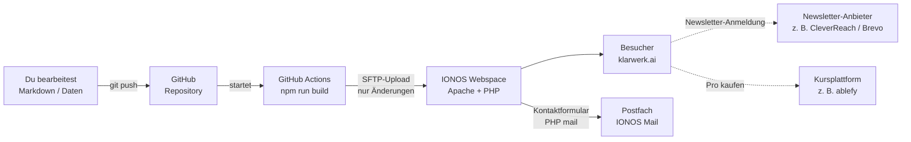

# Architektur & Betrieb auf IONOS

Dieses Dokument beschreibt, wie die Klarwerk‑Website technisch aufgebaut ist, wie sie auf IONOS läuft und welche Entscheidungen dahinterstehen. Wie du Inhalte pflegst, steht in [PFLEGE.md](PFLEGE.md).

---

## 1. Das Prinzip in einem Satz

**Inhalte liegen als Textdateien in Git. Bei jeder Änderung baut GitHub automatisch fertige HTML‑Seiten und lädt sie auf den IONOS‑Webspace.**



## 2. Warum diese Architektur?

| Anforderung | Lösung | Vorteil |
|---|---|---|
| Schnell & günstig hosten | **Statische Website** (reines HTML/CSS/JS) | Läuft auf jedem IONOS‑Webhosting‑Tarif, lädt extrem schnell, keine Datenbank |
| Sicher | Kein CMS‑Backend auf dem Server | Kein WordPress‑Login, keine Plugins, die gehackt werden können, keine Sicherheitsupdates auf dem Server |
| Viele Guides pflegbar | **Astro** mit Markdown‑Dateien | Ein Guide = eine Textdatei. Layout, Navigation und Footer werden automatisch angewendet |
| Nachvollziehbar | **Git** als Ablage | Jede Änderung ist versioniert, alles lässt sich zurückdrehen. Git ist gleichzeitig das Backup |
| Datenschutz (DSGVO) | Hosting in Deutschland, Schriften selbst gehostet, keine Cookies | Kein Cookie‑Banner nötig, solange keine Tracking‑Dienste hinzukommen |
| Veröffentlichen ohne FTP‑Gefummel | **GitHub Actions** | `git push` genügt, nach ca. 1–2 Minuten ist die Änderung online |

## 3. Bausteine

### 3.1 Projektstruktur

```text
ai-knowledge-base/
├── src/
│   ├── content/guides/      ← Guides als Markdown (eine Datei pro Guide)
│   ├── data/
│   │   ├── site.ts          ← Name, E-Mail, Navigation, Footer, Rechtsangaben, Preise
│   │   ├── learning.ts      ← Lernpfade, Kurse, FAQ
│   │   └── prompts.ts       ← Prompt-Bibliothek
│   ├── pages/               ← Eine Datei = eine URL (z. B. pro.astro → /pro/)
│   ├── layouts/             ← Seitenrahmen (Base, Legal)
│   ├── components/          ← Wiederverwendbare Bausteine (Nav, Footer, Newsletter, GuideCard)
│   ├── styles/              ← global.css (Designsystem), pages.css (Unterseiten)
│   ├── scripts/main.js      ← Animationen, Filter, Tabs, Kopieren-Buttons
│   └── content.config.ts    ← Welche Felder ein Guide haben muss (wird beim Build geprüft)
├── public/                  ← Wird 1:1 kopiert: .htaccess, favicon, robots.txt, api/kontakt.php
├── .github/workflows/       ← Automatisches Deployment zu IONOS
├── docs/                    ← Diese Dokumentation
└── dist/                    ← Ergebnis von "npm run build" (nicht in Git)
```

### 3.2 Seitenstruktur (Sitemap)

| URL | Inhalt | Quelle |
|---|---|---|
| `/` | Startseite | `src/pages/index.astro` |
| `/guides/` | Alle Guides mit Suche und Themenfilter | `src/pages/guides/index.astro` |
| `/guides/<name>/` | Einzelner Guide mit Inhaltsverzeichnis | `src/content/guides/<name>.md` |
| `/lernpfade/` | Vier Stufen mit Modulen | `src/data/learning.ts` |
| `/prompts/` | Prompt‑Bibliothek mit Kopieren‑Button | `src/data/prompts.ts` |
| `/kurse/` | Video‑Kurse | `src/data/learning.ts` |
| `/pro/` | Preise und FAQ | `src/pages/pro.astro`, `src/data/learning.ts` |
| `/ueber-uns/` | Mission und Werte | `src/pages/ueber-uns.astro` |
| `/newsletter/` | Newsletter‑Anmeldung | `src/pages/newsletter.astro` |
| `/kontakt/` | Kontaktformular → `/api/kontakt.php` | `src/pages/kontakt/` |
| `/impressum/`, `/datenschutz/`, `/agb/`, `/widerruf/` | Rechtliches (Vorlagen!) | `src/pages/*.astro` |
| `/404.html` | Fehlerseite | `src/pages/404.astro` |
| `/sitemap-index.xml` | Für Suchmaschinen, automatisch erzeugt | `@astrojs/sitemap` |

### 3.3 Was läuft auf dem IONOS‑Server?

Nur drei Dinge:

1. **Apache** liefert die fertigen HTML‑Dateien aus. Die Regeln stehen in `public/.htaccess`: HTTPS erzwingen, www umleiten, Caching, Sicherheits‑Header und die 404‑Seite.
2. **PHP** für genau eine Datei: `api/kontakt.php` verschickt das Kontaktformular über die `mail()`‑Funktion von IONOS.
3. **E‑Mail‑Postfach** `hallo@…` und eine Absenderadresse `website@…` für das Formular.

Keine Datenbank, kein CMS, nichts, was gepatcht werden muss.

### 3.4 Was läuft bewusst *nicht* auf IONOS?

| Funktion | Empfohlener Dienst | Begründung |
|---|---|---|
| **Newsletter** | CleverReach (DE) oder Brevo (EU) | Double‑Opt‑in, Abmeldung, Zustellbarkeit und Nachweispflichten sind dort gelöst. Die Formular‑URL wird in `site.ts → newsletterAction` eingetragen. |
| **Pro‑Mitgliedschaft & Videos** | Kursplattform wie ablefy, Digistore24 oder CopeCart | Zahlungen, Rechnungen, Kündigungsbutton, Zugangsschutz und Video‑Hosting sind dort fertig und rechtlich abgedeckt. Checkout‑Link in `site.ts → proCheckoutUrl`. |
| **Videos** (öffentlich) | YouTube (datensparsam einbinden) oder die Kursplattform | Video‑Streaming ist für Webhosting ungeeignet |

Eine statische Website kann Inhalte nicht wirklich schützen. Pro‑Guides zeigen deshalb auf der Website nur einen Teaser; die Vollversion liegt auf der Kursplattform.

## 4. Einrichtung bei IONOS (einmalig)

### 4.1 Tarif

Jeder **IONOS Webhosting**‑Tarif mit SFTP‑Zugang reicht. Empfehlung: ein Tarif mit **SSH/SFTP**, **PHP** und **inklusive SSL‑Zertifikat**. Eine Datenbank wird nicht benötigt.

### 4.2 Schritte im IONOS‑Kundenbereich

1. **Domain** (z. B. `klarwerk.ai`) bestellen oder übertragen.
2. **Hosting → Webspace:** Einen Ordner `klarwerk` anlegen.
3. **Domains & SSL:** Die Domain dem Ordner `/klarwerk` zuweisen und das SSL‑Zertifikat aktivieren.
4. **Hosting → SFTP & SSH:** Einen SFTP‑Benutzer anlegen. Notiere Hostname, Benutzername und Passwort.
5. **E‑Mail:** Postfächer `hallo@klarwerk.ai` und `website@klarwerk.ai` anlegen. Die Adressen in `public/api/kontakt.php` prüfen.
6. **Auftragsverarbeitungsvertrag (AVV)** mit IONOS im Kundenbereich abschließen (DSGVO).

### 4.3 Automatisches Deployment einrichten

1. Repository auf GitHub anlegen (privat) und den Code hochladen:

   ```bash
   git remote add origin https://github.com/<konto>/klarwerk.git
   git push -u origin main
   ```

2. Auf GitHub unter **Settings → Secrets and variables → Actions** vier Secrets anlegen:

   | Secret | Wert |
   |---|---|
   | `IONOS_SFTP_HOST` | Hostname aus Schritt 4.2.4 |
   | `IONOS_SFTP_USER` | SFTP‑Benutzername |
   | `IONOS_SFTP_PASSWORD` | SFTP‑Passwort |
   | `IONOS_TARGET_DIR` | `/klarwerk` |

3. Unter **Actions → Deploy to IONOS → Run workflow** das erste Deployment manuell starten. Danach läuft es bei jedem Push auf `main` automatisch.

> **Wichtig:** Der Upload nutzt `mirror --delete`. Im Zielordner wird alles gelöscht, was nicht zur Website gehört. Der Zielordner darf daher **nur** für diese Website verwendet werden.

### 4.4 Alternative: IONOS Deploy Now

IONOS bietet mit **Deploy Now** eine eigene GitHub‑Anbindung, die Astro‑Projekte erkennt und selbst baut. Das ist bequemer einzurichten, bindet dich aber enger an den Dienst. Der GitHub‑Actions‑Weg oben funktioniert mit jedem normalen Webhosting‑Tarif und lässt sich jederzeit zu einem anderen Hoster mitnehmen.

### 4.5 Notfall: Manuell hochladen

Falls GitHub nicht verfügbar ist:

```bash
npm run build
```

Dann den **Inhalt** des Ordners `dist/` per SFTP‑Programm (z. B. FileZilla oder WinSCP) in den Ordner `/klarwerk` hochladen. Versteckte Dateien (`.htaccess`) müssen dabei mit übertragen werden.

## 5. Ausbaustufen

| Phase | Wann | Was |
|---|---|---|
| **1 – Start** *(jetzt)* | Sofort | Statische Website auf IONOS Webhosting, Newsletter und Pro über externe Dienste |
| **2 – Redaktion** | Wenn nicht‑technische Personen mitschreiben | Git‑basiertes CMS mit Weboberfläche, z. B. **Pages CMS** oder **Decap CMS**. Beide bearbeiten dieselben Markdown‑Dateien, die Architektur bleibt gleich. |
| **3 – Eigene Automationen** | Wenn eigene Workflows laufen sollen | **IONOS VPS** (ab ca. 2 GB RAM) mit Docker und **n8n**, z. B. für Newsletter‑Automationen, Lead‑Verarbeitung oder die eigenen Demo‑Workflows aus den Guides |
| **4 – Eigene Mitgliederplattform** | Wenn externe Kursplattform zu eng wird | Auf dem VPS z. B. **Ghost** (Mitglieder + Stripe) als eigene Plattform unter `members.klarwerk.ai`. Die statische Hauptseite bleibt unverändert. |

## 6. Datenschutz‑Checkliste

- [ ] AVV mit IONOS abgeschlossen
- [ ] AVV mit Newsletter‑Anbieter abgeschlossen
- [ ] Impressum und Datenschutzerklärung ausgefüllt und geprüft
- [ ] Keine externen Einbindungen ohne Einwilligung (Google Fonts, YouTube‑Embeds, Analytics)
- [ ] Wird ein Analyse‑Tool gewünscht: cookiefreie Lösung wie Plausible oder Matomo (ohne Cookies) wählen und in der Datenschutzerklärung ergänzen
- [ ] Bei jedem neuen Dienst: Datenschutzerklärung aktualisieren
